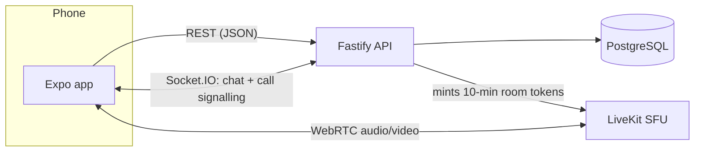

# LandConnect

Land marketplace for **buyers, sellers and brokers**: browse plots, list land with photos and a map pin, chat about a listing, and **call each other with in-app voice and video. Nobody's phone number is ever shared.**

> Land deals in India already happen over WhatsApp calls. LandConnect keeps that familiar flow but ties every chat and call to a listing and keeps numbers private.

**Demo:** [Android APK](https://expo.dev/artifacts/eas/koK3Cx2tLHbQNpUgiaefDeNk-KrkeCICPmGqzQnpeSo.apk) · Video `<add link>` · [Hosted API health](https://api.213-136-67-77.sslip.io/health)

Demo accounts: `buyer@demo.test`, `seller@demo.test`, `broker@demo.test`, password `landconnect123`.

## Features

| Area | What's there |
|---|---|
| Auth & roles | Sign up as Buyer / Seller / Broker (RERA id required for brokers). Email verification and forgot-password with 6-digit codes. argon2id, 15-min JWT, rotating refresh tokens with reuse detection. Roles enforced in the API and the UI, and **switchable later** from Profile (broker needs RERA; back to buyer only with no live listing). |
| Listings | Feed with search, land-type chips, price bands, saved plots, infinite scroll. Create with up to 10 photos (compressed on device), area in acre/guntha/cent/sq ft/sq yd/hectare, ₹ lakh/crore pricing with per-unit price, title documents, road/water/zoning. Edit, mark sold, delete. Input limits match the server's schema. |
| Maps | Map tab with price pins for the visible area, clusters, light/dark styles. Listing pin set in a full-screen picker with reverse geocoding; approximate (~1 km) location by default. |
| Messaging | One thread per buyer per listing with the plot pinned, live delivery, typing, presence, unread counts, optimistic send with retry, in-app banners for messages in other chats. **Deal rooms**: group chat for a seller/broker and people they already chat with, members sheet, leave room. |
| **Calling** | Voice & video: **initiate → ring (30 s) → accept / decline (with quick reply) / cancel / missed / busy → end**, ringback and ringtone, speaker toggle while ringing, "answered elsewhere" on other devices, call log, call bubbles in chat. The call keeps running when the app is minimised (Android foreground service). Tap to swap the video tiles. **Group meetings** in deal rooms with a WhatsApp-style grid and an active-speaker ring. |
| Privacy & safety | Phone/email never leave the API for other users (single DTO + test). Calls only inside a shared conversation, per-user "allow calls" switch, blocking (also stops 1:1 messages and adding to groups), approximate locations. Socket events validated and rate-limited; uploads checked by their bytes. |

## Stack

**Hosting:** API in Docker on a VM behind Caddy (TLS) · PostgreSQL on Neon (Frankfurt, same region as the VM) · media on LiveKit Cloud · email via Resend

**Mobile:** Expo SDK 58 (React Native 0.88, New Architecture, React Compiler) · Expo Router with native tabs · TanStack Query · Zustand · LiveKit React Native · react-native-maps · Reanimated 4 · FlashList v2 · expo-image
**API:** Node 24 (runs TypeScript directly) · Fastify 5 + Zod · Socket.IO 4 · Drizzle ORM · PostgreSQL · LiveKit server SDK · Nodemailer
**Shared:** `packages/shared`: Zod schemas, DTO types and typed Socket.IO events used by both sides.



Our server owns *who can call whom and the call lifecycle*; LiveKit only carries media. Details: [docs/ARCHITECTURE.md](docs/ARCHITECTURE.md) · decisions & research: [docs/DECISIONS.md](docs/DECISIONS.md) · engineering rules: [CLAUDE.md](CLAUDE.md).

## Run it locally

Prerequisites: Node 24, pnpm 10, Docker (or any Postgres 16), a phone with the dev build installed.

```bash
pnpm install
pnpm db:up                                   # Postgres :5433 + LiveKit dev server :7880 + Mailpit (email) :8025
cp apps/api/.env.example apps/api/.env       # set PUBLIC_URL / LIVEKIT_URL to your LAN IP
pnpm --filter api db:migrate && pnpm --filter api db:seed
pnpm dev:api                                 # http://localhost:4000/health
```

```bash
cp apps/mobile/.env.example apps/mobile/.env # EXPO_PUBLIC_API_URL=http://<LAN-IP>:4000
cd apps/mobile && npx eas-cli build -p android --profile development   # once; installs the dev client
pnpm dev:mobile
```

WebRTC needs native code, so the app runs in a **development build**, not Expo Go.

**Quick look in a browser:** `pnpm --filter mobile web` runs the whole UI against the real API. Native-only pieces are swapped for web stand-ins in `apps/mobile/web-preview/`: an OpenStreetMap embed instead of Google Maps, and the call screens with real ringing/accept/decline signalling but avatars instead of audio/video. Phones never load these. Without Android Studio or Xcode, EAS builds it in the cloud.

**Demo accounts** (seeded): `buyer@demo.test`, `seller@demo.test`, `broker@demo.test`, password `landconnect123`. The sign-in screen has one-tap buttons for them.

## Build the APK

```bash
cd apps/mobile
npx eas-cli build -p android --profile preview    # installable APK, points at the hosted API
```

## Deploy the API

Production runs on one VM with `docker compose` behind Caddy for TLS, Postgres on Neon and calls on LiveKit Cloud. Steps, firewall and the redeploy command: [deploy/README.md](deploy/README.md). Neon is linked with `neon.ts`; `neon deploy` writes the connection strings to `.env.local`. Keep the database in the same region as the API: a call invite makes several queries in a row, and Singapore ↔ France cost about 4 s per ring.

`render.yaml` is an alternative Render blueprint, and [docs/SELF_HOSTING.md](docs/SELF_HOSTING.md) covers running LiveKit yourself.

## Quality

```bash
pnpm check        # Biome lint + tsc in every package + all tests
```

- **API (38 tests)** against a real Postgres and real Socket.IO clients: auth and refresh-token theft detection, email codes, RBAC and role switching, **no phone numbers in any response**, cursor pagination, map bbox, live chat, blocking, deal-room rules (contacts only, no blocked people, leave), socket payload limits and flood throttling, upload byte checks, and the full call state machine (accept, reject, missed timeout, busy, unauthorized caller, opt-out, multi-device).
- **Shared (9 tests):** formatters and the text rules (names in any script, no emoji in names/titles/places, numeric caps).
- **End to end (11 flows, Playwright)** through the web build against the real API: sign-up validation, listing with photo, search with no phone shown, live chat, video call accept/end, decline with quick reply, missed call, call log, edit and mark sold, forgot password via email code. See [e2e/README.md](e2e/README.md).

## Docs

- [docs/TECHNICAL.md](docs/TECHNICAL.md): technical documentation (technologies, architecture, decisions, challenges)
- [docs/AI_USAGE.md](docs/AI_USAGE.md): how AI tools were used
- [deploy/README.md](deploy/README.md): how production is deployed
- [docs/SELF_HOSTING.md](docs/SELF_HOSTING.md): run calls on your own LiveKit server (laptop or VM), or on LiveKit Cloud
- [docs/PLAN.md](docs/PLAN.md): timeline and scope
- [docs/ARCHITECTURE.md](docs/ARCHITECTURE.md): system design, schema, events, call sequence
- [docs/DECISIONS.md](docs/DECISIONS.md): competitor research and technology comparison (LiveKit vs Stream / Agora / ZEGOCLOUD / Jitsi / raw WebRTC)
- [docs/UX.md](docs/UX.md): screen spec and design system
- [docs/SUBMISSION.md](docs/SUBMISSION.md): demo script, AI-usage template, interview prep
- [docs/mockup/index.html](docs/mockup/index.html): clickable HTML prototype
