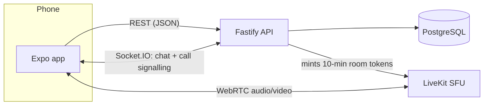

# LandConnect

Land marketplace for **buyers, sellers and brokers**: browse plots, list land with photos and a map pin, chat about a listing, and **call each other with in-app voice and video. Nobody's phone number is ever shared.**

> Land deals in India already happen over WhatsApp calls. LandConnect keeps that familiar flow but ties every chat and call to a listing and keeps numbers private.

**Demo:** APK `<link>` · Video `<link>` · API `<https://…onrender.com/health>`

## Features

| Area | What's there |
|---|---|
| Auth & roles | Sign up as Buyer / Seller / Broker (RERA id required). argon2id, 15-min JWT, rotating refresh tokens with reuse detection. Roles enforced in the API and the UI. |
| Listings | Community feed with search, land-type chips, price bands, infinite scroll. Create with up to 10 photos (compressed on device), area in acre/guntha/cent/sq ft/sq yd/hectare, ₹ lakh/crore pricing with per-unit price, title documents, road/water/zoning. Edit status (sold), delete, save. |
| Maps | Map tab loads listings for the visible area with price-label markers; listing location picker with reverse geocoding; approximate (~1 km) locations by default. |
| Messaging | One thread per buyer per listing, listing card pinned in the chat, live delivery, typing, presence, unread counts, optimistic send with retry. **Deal rooms**: group chat for sellers/brokers + invited buyers. |
| **Calling** | Voice & video: **initiate → ring (30 s) → accept / decline (with quick-reply) / cancel / missed / busy → end**, multi-device "answered elsewhere", call log, call bubbles in chat. Group video meetings in deal rooms. Opus DTX + RED, echo cancellation, simulcast + adaptive stream. |
| Privacy | Phone/email never leave the API for other users (single DTO + test). Calls only between people in a shared conversation, per-user "allow calls" switch, blocking, approximate locations. |

## Stack

**Mobile:** Expo SDK 58 (React Native 0.88, New Architecture, React Compiler) · Expo Router with native tabs · TanStack Query · Zustand · LiveKit React Native · react-native-maps · Reanimated 4 · FlashList v2 · expo-image
**API:** Node 24 (runs TypeScript directly) · Fastify 5 + Zod · Socket.IO 4 · Drizzle ORM · PostgreSQL · LiveKit server SDK
**Shared:** `packages/shared`: Zod schemas, DTO types and typed Socket.IO events used by both sides.



Our server owns *who can call whom and the call lifecycle*; LiveKit only carries media. Details: [docs/ARCHITECTURE.md](docs/ARCHITECTURE.md) · decisions & research: [docs/DECISIONS.md](docs/DECISIONS.md) · engineering rules: [CLAUDE.md](CLAUDE.md).

## Run it locally

Prerequisites: Node 24, pnpm 10, Docker (or any Postgres 16), a phone with the dev build installed.

```bash
pnpm install
pnpm db:up                                   # Postgres :5433 + LiveKit dev server :7880
cp apps/api/.env.example apps/api/.env       # set PUBLIC_URL / LIVEKIT_URL to your LAN IP
pnpm --filter api db:migrate && pnpm --filter api db:seed
pnpm dev:api                                 # http://localhost:4000/health
```

```bash
cp apps/mobile/.env.example apps/mobile/.env # EXPO_PUBLIC_API_URL=http://<LAN-IP>:4000
cd apps/mobile && npx eas-cli build -p android --profile development   # once; installs the dev client
pnpm dev:mobile
```

WebRTC needs native code, so the app runs in a **development build**, not Expo Go.

**Quick look in a browser:** `pnpm --filter mobile web` runs the whole UI against the real API. Native-only pieces are swapped for web stand-ins in `apps/mobile/web-preview/`: an OpenStreetMap embed instead of Google Maps, and the call screens with real ringing/accept/decline signalling but avatars instead of audio/video. Phones never load these. Without Android Studio or Xcode, EAS builds it in the cloud.

**Demo accounts** (seeded): `buyer@demo.test`, `seller@demo.test`, `broker@demo.test`, password `landconnect123`. The sign-in screen has one-tap buttons for them.

## Build the APK

```bash
cd apps/mobile
npx eas-cli build -p android --profile preview    # installable APK, points at the hosted API
```

## Deploy the API (free tier)

`render.yaml` is a Render blueprint: Node 24 web service, migrations run before each deploy. Use Supabase or Neon for Postgres; for media use self-hosted LiveKit or LiveKit Cloud ([docs/SELF_HOSTING.md](docs/SELF_HOSTING.md)); set `DATABASE_URL`, `JWT_SECRET`, `PUBLIC_URL`, `LIVEKIT_URL`, `LIVEKIT_API_KEY`, `LIVEKIT_API_SECRET`.

## Quality

```bash
pnpm check        # Biome lint + tsc in every package + all tests
```

API tests run against a real Postgres and real Socket.IO clients: auth and refresh-token theft detection, RBAC, **no phone numbers in any response**, cursor pagination, map bbox, live chat, and the full call state machine (accept, reject, missed timeout, busy, unauthorized caller, opt-out).

## Docs

- [docs/TECHNICAL.md](docs/TECHNICAL.md): technical documentation (technologies, architecture, decisions, challenges)
- [docs/AI_USAGE.md](docs/AI_USAGE.md): how AI tools were used
- [docs/SELF_HOSTING.md](docs/SELF_HOSTING.md): run calls on your own LiveKit server (laptop or VM), or on LiveKit Cloud
- [docs/PLAN.md](docs/PLAN.md): timeline and scope
- [docs/ARCHITECTURE.md](docs/ARCHITECTURE.md): system design, schema, events, call sequence
- [docs/DECISIONS.md](docs/DECISIONS.md): competitor research and technology comparison (LiveKit vs Stream / Agora / ZEGOCLOUD / Jitsi / raw WebRTC)
- [docs/UX.md](docs/UX.md): screen spec and design system
- [docs/SUBMISSION.md](docs/SUBMISSION.md): demo script, AI-usage template, interview prep
- [docs/mockup/index.html](docs/mockup/index.html): clickable HTML prototype
