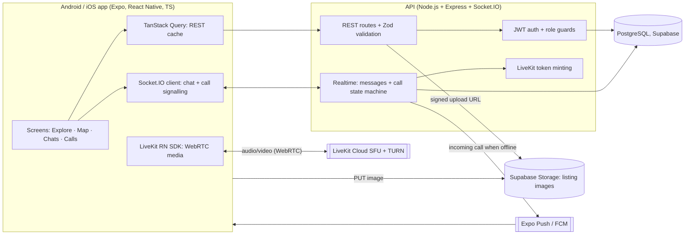
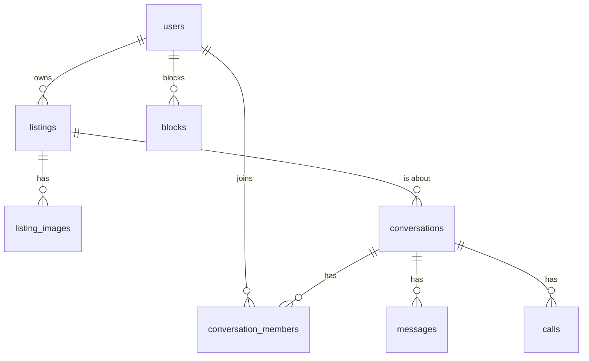
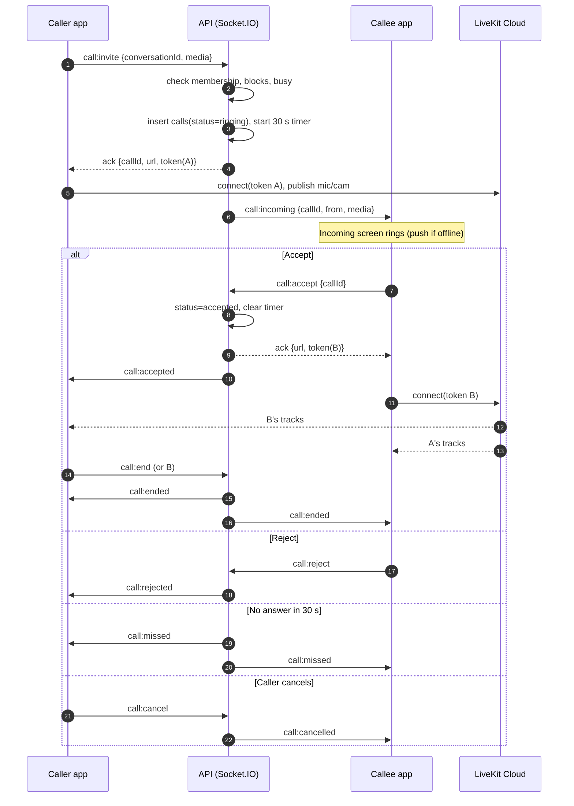
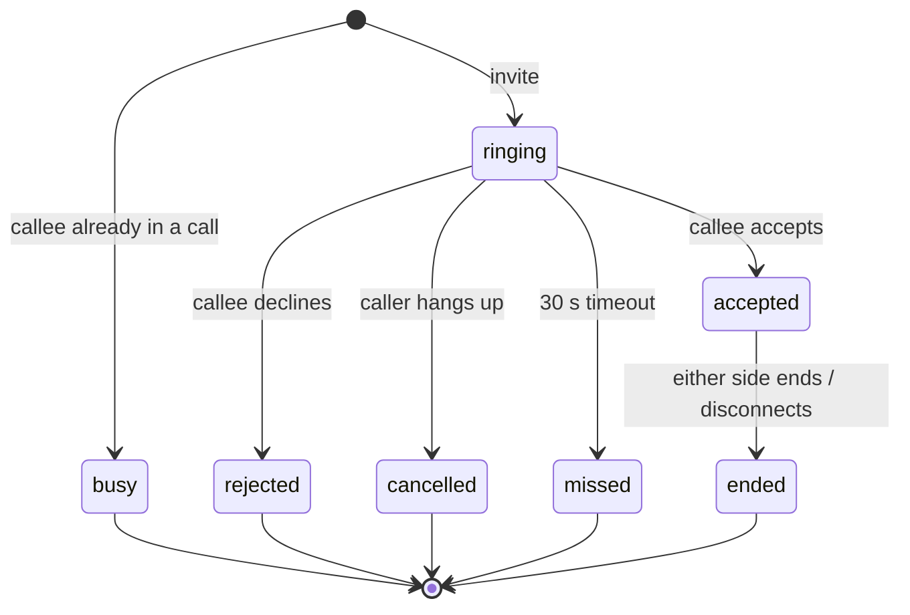

# LandConnect: architecture

> **Implementation status (23 Nov 2026).** This doc was written before the build; the code is the source of truth and [CLAUDE.md](../CLAUDE.md) lists the rules. Where the build differs from the sketches below:
> - **Fastify 5 + Zod** instead of Express (typed routes, OpenAPI at `/openapi.json`, faster). Node 24 runs the TypeScript directly; there is no build step.
> - **Drizzle** schema in `apps/api/src/db/schema.ts`, generated SQL in `apps/api/drizzle/`. Timestamps are `timestamptz(3)`.
> - Calls end with one event, `call:closed { reason }`, instead of separate rejected/cancelled/missed events (see `packages/shared/src/events.ts`).
> - **Photos are stored in Postgres** (`uploads` table, immutable cache headers) because free hosts wipe their disk on restart. Phones compress photos to about 1600 px first.
> - **Blocking** also stops messages in an existing 1:1 conversation (not only new chats and calls). `GET /me/blocks` lists blocked people for the Unblock screen.
> - `GET /listings?saved=true` lists the viewer's saved plots; sold ones stay there with a Sold tag. Uploaded photos are served with `Cross-Origin-Resource-Policy: cross-origin` so the app can embed them.
> - On the phone, the call UI is a **root-level overlay** driven by the call store rather than a route, so an incoming call can never race navigation.

## 1. System overview



**Key split:** our server decides who may call whom and runs the ringing lifecycle. LiveKit only moves audio and video for people holding a token our server issued. Phone numbers never cross either path.

---

## 2. Stack

| Layer | Choice | Why (one line) |
|---|---|---|
| Mobile | **Expo SDK (latest) + dev build, Expo Router, TypeScript** | Fastest RN setup, file-based routing, EAS builds the APK. A dev build is required for WebRTC. |
| Server state | TanStack Query | Caching, pagination and refetch without hand-written stores |
| Client state | Zustand (auth + active call only) | Two small stores; no Redux boilerplate |
| Calls (media) | **LiveKit** (`@livekit/react-native`, Expo plugin) | Open-source SFU, TURN included, same tech for 1:1 and group calls |
| Calls (ringing) | **Own Socket.IO signalling** | Accept / reject / timeout / busy are ours to explain in the interview |
| Chat | Socket.IO + Postgres | Same socket as signalling; no extra vendor |
| Maps | `react-native-maps` + `expo-location` | Native maps; free reverse geocoding through the OS geocoder |
| Images | `expo-image-picker` → `expo-image-manipulator` (resize) → Supabase Storage signed upload; shown with `expo-image` | Phone uploads directly; API never streams bytes |
| API | **Node.js 22 + Express + TypeScript + Zod** | One language end to end; first-class Socket.IO and LiveKit server SDKs |
| DB | **PostgreSQL** (Supabase hosted), SQL migrations, a thin query layer (Drizzle or Prisma `db pull`) | The brief names Postgres; constraints live in the DB |
| Auth | Own JWT: argon2id, 15 min access token, 30 day rotating refresh token | The brief evaluates "authentication and authorization mechanisms" |
| Push | Expo Push (FCM underneath) | One HTTP call from the server; no native push code for P1 |
| Hosting | API on Render (or Railway); DB + Storage on Supabase; media on LiveKit Cloud | Free tiers cover the prototype |
| Build | EAS Build `preview` profile → APK | Shareable install link |

---

## 3. Repo layout

```
landconnect/
├─ apps/
│  ├─ api/
│  │  ├─ src/
│  │  │  ├─ index.ts            # express + socket.io bootstrap
│  │  │  ├─ db.ts               # pg pool / ORM client
│  │  │  ├─ auth.ts             # register, login, refresh, requireAuth, can(...roles)
│  │  │  ├─ listings.ts         # CRUD, filters, bbox, enquire, uploads
│  │  │  ├─ conversations.ts    # list, messages, rooms, share-phone, block
│  │  │  ├─ realtime/
│  │  │  │  ├─ socket.ts        # handshake auth, user rooms, message events
│  │  │  │  └─ calls.ts         # call state machine + LiveKit tokens
│  │  │  └─ push.ts             # Expo push for offline callees
│  │  ├─ migrations/001_init.sql
│  │  ├─ seed.ts
│  │  └─ .env.example
│  └─ mobile/
│     ├─ app/                    # Expo Router
│     │  ├─ (auth)/login.tsx  register.tsx
│     │  ├─ (tabs)/_layout.tsx  index.tsx(explore)  map.tsx  chats.tsx  calls.tsx
│     │  ├─ listing/[id].tsx  listing/new.tsx  listing/[id]/edit.tsx
│     │  ├─ chat/[id].tsx
│     │  ├─ call/incoming.tsx  call/[id].tsx  room/[id].tsx
│     │  └─ profile.tsx
│     ├─ src/
│     │  ├─ api.ts              # fetch wrapper with token refresh
│     │  ├─ socket.ts           # singleton socket, reconnect with fresh token
│     │  ├─ calls/              # useCallEvents, CallScreen, controls
│     │  ├─ components/         # ListingCard, Avatar, RoleBadge, PriceTag, MapPinPicker
│     │  └─ format.ts           # ₹ lakh/crore, area units
│     ├─ app.json  eas.json
│     └─ .env.example
└─ docs/
```

---

## 4. Data model



`migrations/001_init.sql`:

```sql
create extension if not exists pgcrypto;

create type user_role      as enum ('buyer','seller','broker');
create type land_type      as enum ('agricultural','residential','commercial','industrial','farmhouse');
create type area_unit      as enum ('sqft','sqyd','acre','guntha','cent','hectare');
create type listing_status as enum ('draft','active','sold','archived');
create type call_media     as enum ('audio','video');
create type call_status    as enum ('ringing','accepted','rejected','missed','cancelled','busy','ended');

create table users (
  id               uuid primary key default gen_random_uuid(),
  name             text not null,
  email            text not null unique,
  phone            text unique,                       -- never returned by public endpoints
  password_hash    text not null,                     -- argon2id
  role             user_role not null,
  broker_license   text,
  avatar_url       text,
  phone_visibility text not null default 'nobody' check (phone_visibility in ('nobody','shared')),
  call_policy      text not null default 'chatted' check (call_policy in ('chatted','nobody')),
  push_token       text,
  created_at       timestamptz not null default now(),
  check (role <> 'broker' or broker_license is not null)
);

create table refresh_tokens (
  id          uuid primary key default gen_random_uuid(),
  user_id     uuid not null references users on delete cascade,
  token_hash  text not null unique,                   -- sha256 of the opaque token
  expires_at  timestamptz not null,
  revoked_at  timestamptz
);

create table listings (
  id               uuid primary key default gen_random_uuid(),
  owner_id         uuid not null references users on delete cascade,
  land_owner_name  text,                              -- broker listing for a client; private
  title            text not null check (length(title) between 5 and 120),
  description      text not null default '',
  price_inr        bigint not null check (price_inr > 0),
  area_value       numeric(12,2) not null check (area_value > 0),
  area_unit        area_unit not null,
  land_type        land_type not null,
  lat              double precision not null check (lat between -90 and 90),
  lng              double precision not null check (lng between -180 and 180),
  approx_location  boolean not null default true,
  address          text not null default '',
  city             text not null default '',
  status           listing_status not null default 'active',
  created_at       timestamptz not null default now(),
  updated_at       timestamptz not null default now()
);
create index on listings (status, land_type, created_at desc);
create index on listings (lat, lng);                  -- ponytail: bbox on two floats; PostGIS + GiST when radius search matters

create table listing_images (
  id          uuid primary key default gen_random_uuid(),
  listing_id  uuid not null references listings on delete cascade,
  url         text not null,
  position    int  not null default 0
);

create table saved_listings (
  user_id    uuid references users on delete cascade,
  listing_id uuid references listings on delete cascade,
  primary key (user_id, listing_id)
);

create table conversations (
  id          uuid primary key default gen_random_uuid(),
  kind        text not null check (kind in ('direct','room')),
  title       text,
  listing_id  uuid references listings on delete set null,
  created_by  uuid not null references users,
  created_at  timestamptz not null default now()
);

create table conversation_members (
  conversation_id uuid references conversations on delete cascade,
  user_id         uuid references users on delete cascade,
  is_admin        boolean not null default false,
  shared_phone    boolean not null default false,   -- "share my number in this chat"
  last_read_at    timestamptz,
  primary key (conversation_id, user_id)
);

create table messages (
  id              uuid primary key default gen_random_uuid(),
  conversation_id uuid not null references conversations on delete cascade,
  sender_id       uuid references users,             -- null for system messages
  kind            text not null default 'text' check (kind in ('text','image','system','call')),
  body            text not null,
  meta            jsonb,
  created_at      timestamptz not null default now()
);
create index on messages (conversation_id, created_at desc);

create table calls (
  id              uuid primary key default gen_random_uuid(),
  conversation_id uuid not null references conversations on delete cascade,
  caller_id       uuid not null references users,
  media           call_media not null,
  status          call_status not null default 'ringing',
  room_name       text not null unique,
  started_at      timestamptz not null default now(),
  answered_at     timestamptz,
  ended_at        timestamptz
);

create table blocks (
  blocker_id uuid references users on delete cascade,
  blocked_id uuid references users on delete cascade,
  primary key (blocker_id, blocked_id)
);
```

---

## 5. REST API

All routes are JSON. 🔒 = needs `Authorization: Bearer <access>`. Role column = who passes `can(...)`.

| Method | Path | Role | Notes |
|---|---|---|---|
| POST | `/auth/register` | public | `{name,email,password,role,phone?,brokerLicense?}` → `{user, accessToken, refreshToken}` |
| POST | `/auth/login` | public | Rate-limited (5/min/IP) |
| POST | `/auth/refresh` | public | Rotates: old token revoked, new one issued. Reuse of a revoked token revokes the whole family. |
| POST | `/auth/logout` | 🔒 any | Revokes the refresh token |
| POST | `/auth/email/code` | 🔒 any | Emails a 6-digit code to verify the address (sign-up already sends one). One per 30 s, else 429 |
| POST | `/auth/email/verify` | 🔒 any | `{code}` → `Me` with `emailVerified: true`. 5 wrong tries kill the code; codes live 10 min |
| POST | `/auth/password/forgot` | public | `{email}` → always 204, so it can't be used to find out who has an account |
| POST | `/auth/password/reset` | public | `{email, code, password}` → `{user, accessToken, refreshToken}`; signs out every other device |
| GET / PATCH | `/me` | 🔒 any | Privacy settings, push token, avatar |
| GET | `/listings` | public | `?type&q&minPrice&maxPrice&bbox=minLng,minLat,maxLng,maxLat&cursor` |
| GET | `/listings/:id` | public | Coordinates rounded to 2 dp (≈1.1 km) if `approx_location` and the caller isn't owner/enquirer |
| POST | `/listings` | 🔒 seller, broker | |
| PATCH / DELETE | `/listings/:id` | 🔒 owner | `where id=$1 and owner_id=$me`; delete = `status='archived'` |
| POST | `/uploads/sign` | 🔒 seller, broker | Returns a Supabase signed upload URL for `listing-images/<uid>/<uuid>.jpg` |
| POST / DELETE | `/listings/:id/save` | 🔒 any | |
| POST | `/listings/:id/enquire` | 🔒 any except owner | Finds or creates the direct conversation (me, owner) for this listing |
| GET | `/conversations` | 🔒 member | Last message, unread count, listing summary |
| GET | `/conversations/:id/messages` | 🔒 member | `?before=<ts>` |
| POST | `/rooms` | 🔒 seller, broker (listing owner) | `{listingId,title,memberIds[]}`; members must have enquired on the listing |
| POST | `/conversations/:id/share-phone` | 🔒 member | Sets `shared_phone=true` for me in this conversation |
| GET | `/conversations/:id/contact` | 🔒 member | Phones only of members who shared in this conversation |
| GET | `/calls` | 🔒 any | Call log for me |
| POST / DELETE | `/users/:id/block` | 🔒 any | |
| GET | `/health` | public | Wake-up ping before the demo |

**Public user DTO:** `{ id, name, role, avatarUrl, brokerVerified }`. There is no `phone` and no `email`. Put it in one `toPublicUser()` function and use it everywhere.

---

## 6. Realtime (Socket.IO)

Handshake: `io(URL, { auth: { token: accessToken } })`. The server verifies the JWT and runs `socket.join('user:' + id)`. Every device of a user is in that room, so emitting to a user reaches all their devices.

| Direction | Event | Payload | Ack |
|---|---|---|---|
| C→S | `msg:send` | `{conversationId, body}` | `{message}` |
| S→C | `msg:new` | `{message}` | |
| C→S | `msg:read` | `{conversationId}` | |
| C→S | `call:invite` | `{conversationId, media}` | `{callId, url, token}` or `{error: 'busy' \| 'not_allowed'}` |
| S→C | `call:incoming` | `{callId, media, conversationId, from:{id,name,role}, listingTitle}` | |
| C→S | `call:accept` | `{callId}` | `{url, token}` or `{error:'gone'}` |
| C→S | `call:reject` / `call:cancel` / `call:end` | `{callId}` | |
| S→C | `call:accepted` / `call:rejected` / `call:cancelled` / `call:missed` / `call:ended` | `{callId}` | |
| S→C | `call:answered_elsewhere` | `{callId}` | Stops ringing on your other devices |
| C→S | `room:join` | `{conversationId}` | `{url, token}`. Group meeting, no ringing. |

---

## 7. Calling design (R6, the key requirement)

### 7.1 Call lifecycle



The caller joins the LiveKit room while it rings. When the callee joins, media flows at once, with no second round trip.

### 7.2 State machine



### 7.3 Server: `apps/api/src/realtime/calls.ts` (sketch; adapt the `db.*` calls to your query layer)

```ts
import type { Server, Socket } from 'socket.io';
import { AccessToken } from 'livekit-server-sdk';
import { randomUUID } from 'node:crypto';
import { db } from '../db';
import { sendCallPush } from '../push';

const RING_MS = 30_000;
// ponytail: in-memory call state works for one API instance.
// For more than one, move to Redis and add @socket.io/redis-adapter.
type Ring = { callerId: string; calleeIds: string[]; timer: NodeJS.Timeout };
const ringing = new Map<string, Ring>();
const busy = new Set<string>();

async function joinInfo(userId: string, name: string, room: string) {
  const at = new AccessToken(process.env.LIVEKIT_API_KEY!, process.env.LIVEKIT_API_SECRET!, {
    identity: userId, name, ttl: '10m',
  });
  at.addGrant({ roomJoin: true, room, canPublish: true, canSubscribe: true });
  return { url: process.env.LIVEKIT_URL!, token: await at.toJwt() };
}

export function callHandlers(io: Server, socket: Socket) {
  const me = socket.data.user as { id: string; name: string; role: string };
  const toUser = (id: string) => io.to(`user:${id}`);

  async function settle(callId: string, status: 'rejected' | 'missed' | 'cancelled') {
    const r = ringing.get(callId);
    if (!r) return;                                   // already settled
    clearTimeout(r.timer);
    ringing.delete(callId);
    busy.delete(r.callerId);
    await db.calls.update(callId, { status, ended_at: new Date() });
    for (const id of [r.callerId, ...r.calleeIds]) toUser(id).emit(`call:${status}`, { callId });
  }

  socket.on('call:invite', async ({ conversationId, media }, ack) => {
    const memberIds = await db.members.userIds(conversationId);
    if (!memberIds.includes(me.id)) return ack({ error: 'not_allowed' });
    const callees = memberIds.filter((id) => id !== me.id);
    if (await db.blocks.anyBetween(me.id, callees)) return ack({ error: 'not_allowed' });
    if (await db.users.anyRefusesCalls(callees))   return ack({ error: 'not_allowed' });
    if (callees.some((id) => busy.has(id)))         return ack({ error: 'busy' });

    const call = await db.calls.insert({
      conversation_id: conversationId, caller_id: me.id, media, room_name: `call_${randomUUID()}`,
    });
    busy.add(me.id);
    ringing.set(call.id, {
      callerId: me.id, calleeIds: callees,
      timer: setTimeout(() => settle(call.id, 'missed'), RING_MS),
    });

    const payload = { callId: call.id, media, conversationId, from: { id: me.id, name: me.name, role: me.role } };
    for (const id of callees) {
      toUser(id).emit('call:incoming', payload);
      const online = (await io.in(`user:${id}`).fetchSockets()).length > 0;
      if (!online) sendCallPush(id, payload);         // P1: wakes the app, which then replays below
    }
    ack({ callId: call.id, ...(await joinInfo(me.id, me.name, call.room_name)) });
  });

  socket.on('call:accept', async ({ callId }, ack) => {
    const r = ringing.get(callId);
    if (!r || !r.calleeIds.includes(me.id)) return ack({ error: 'gone' });
    clearTimeout(r.timer);
    ringing.delete(callId);
    busy.add(me.id);
    const call = await db.calls.update(callId, { status: 'accepted', answered_at: new Date() });
    toUser(r.callerId).emit('call:accepted', { callId });
    socket.to(`user:${me.id}`).emit('call:answered_elsewhere', { callId });
    ack(await joinInfo(me.id, me.name, call.room_name));
  });

  socket.on('call:reject', ({ callId }) => {
    if (ringing.get(callId)?.calleeIds.includes(me.id)) settle(callId, 'rejected');
  });
  socket.on('call:cancel', ({ callId }) => {
    if (ringing.get(callId)?.callerId === me.id) settle(callId, 'cancelled');
  });

  socket.on('call:end', async ({ callId }) => {
    const call = await db.calls.get(callId);
    if (!call || call.status !== 'accepted') return;
    const memberIds = await db.members.userIds(call.conversation_id);
    if (!memberIds.includes(me.id)) return;
    await db.calls.update(callId, { status: 'ended', ended_at: new Date() });
    for (const id of memberIds) { busy.delete(id); toUser(id).emit('call:ended', { callId }); }
    await db.messages.insertCallSummary(call);        // "Video call · 4:12" bubble in the chat
  });

  // App opened from a push, or reconnected: replay any call still ringing for me.
  for (const [callId, r] of ringing) {
    if (r.calleeIds.includes(me.id)) db.calls.incomingPayload(callId).then((p) => socket.emit('call:incoming', p));
  }

  socket.on('disconnect', async () => {
    const left = await io.in(`user:${me.id}`).fetchSockets();
    if (left.length) return;                          // another device is still online
    for (const [callId, r] of ringing) if (r.callerId === me.id) settle(callId, 'cancelled');
    // An accepted call is ended by LiveKit's participant_left / room_finished webhook (see 7.6)
  });
}
```

### 7.4 Client: setup

```bash
npx expo install @livekit/react-native @livekit/react-native-webrtc @livekit/react-native-expo-plugin @config-plugins/react-native-webrtc livekit-client expo-dev-client
```

`app.json` plugins: `"@livekit/react-native-expo-plugin"`, `"@config-plugins/react-native-webrtc"`. Add camera and microphone permission strings. Call `registerGlobals()` once in the app entry, before any LiveKit import is used.

### 7.5 Client: ringing + call screen (sketch)

```tsx
// src/calls/useCallEvents.ts: mounted once in the root layout
export function useCallEvents() {
  const router = useRouter();
  const setCall = useCallStore((s) => s.set);
  useEffect(() => {
    const onIncoming = (p: IncomingCall) => { setCall({ ...p, phase: 'incoming' }); router.push('/call/incoming'); };
    const close = (reason: string) => () => { setCall(null); router.back(); toast(reason); };
    socket.on('call:incoming', onIncoming);
    socket.on('call:accepted', () => setCall((c) => c && { ...c, phase: 'live' }));
    socket.on('call:rejected', close('Call declined'));
    socket.on('call:missed', close('No answer'));
    socket.on('call:cancelled', close('Caller hung up'));
    socket.on('call:answered_elsewhere', close('Answered on another device'));
    socket.on('call:ended', close('Call ended'));
    return () => { socket.removeAllListeners(); };
  }, []);
}

// app/call/[id].tsx
import { LiveKitRoom, AudioSession, useTracks, VideoTrack, useLocalParticipant, isTrackReference } from '@livekit/react-native';
import { Track } from 'livekit-client';

export default function CallScreen() {
  const { url, token, media, callId } = useCallStore((s) => s.call!);
  useEffect(() => { AudioSession.startAudioSession(); return () => { AudioSession.stopAudioSession(); }; }, []);
  return (
    <LiveKitRoom serverUrl={url} token={token} connect audio video={media === 'video'}
                 onDisconnected={() => socket.emit('call:end', { callId })}>
      <Stage />
      <Controls callId={callId} />
    </LiveKitRoom>
  );
}

function Stage() {
  const tracks = useTracks([Track.Source.Camera]);
  return tracks.filter(isTrackReference).map((t) => (
    <VideoTrack key={t.participant.identity} trackRef={t}
                style={t.participant.isLocal ? styles.pip : styles.full} />
  ));
}

function Controls({ callId }: { callId: string }) {
  const { localParticipant, isMicrophoneEnabled, isCameraEnabled } = useLocalParticipant();
  return (
    <Row>
      <RoundBtn icon={isMicrophoneEnabled ? 'mic' : 'mic-off'} onPress={() => localParticipant.setMicrophoneEnabled(!isMicrophoneEnabled)} />
      <RoundBtn icon={isCameraEnabled ? 'video' : 'video-off'} onPress={() => localParticipant.setCameraEnabled(!isCameraEnabled)} />
      <RoundBtn icon="flip" onPress={() => flipCamera(localParticipant)} />  {/* restart camera track with the other facingMode */}
      <RoundBtn icon="phone-off" danger onPress={() => socket.emit('call:end', { callId })} />
    </Row>
  );
}
```

Check method names against the current `@livekit/react-native` docs when you implement. The SDK moves quickly.

### 7.6 Edge cases covered

| Case | Handling |
|---|---|
| Callee offline | Push notification (P1). On open, the socket connects and the server replays the pending invite. After 30 s → `missed`. |
| Callee on another call | `busy` ack; caller sees "On another call" |
| Callee has two devices | Both ring; first accept wins; others get `call:answered_elsewhere` |
| Accept after timeout or cancel | `call:accept` ack returns `{error:'gone'}` → "Call no longer available" |
| Caller app killed while ringing | Last socket disconnect → `cancelled` |
| App killed mid-call | LiveKit webhook `participant_left` / `room_finished` → mark `ended` (P1; otherwise the other side presses End) |
| Network switch Wi-Fi ↔ 4G | LiveKit reconnects on its own; UI shows "Reconnecting…" from the room's connection state |
| Camera or mic permission denied | Screen explains and offers Open Settings; a voice call still works without the camera |
| Abuse / strangers | Calls only within a shared conversation; blocks and `call_policy` checked server-side |

### 7.7 Meeting rooms (R5)
- **Model:** a `conversations` row with `kind='room'`, tied to a listing, created by the listing's seller or broker. Members are invited from buyers who enquired on that listing.
- **Meeting:** `room:join` mints a token for the fixed room name `room_<conversationId>`. There's no ringing: members see a "Meeting started · Join" banner in the chat (a system message plus a socket event).
- Same `CallScreen`, with a grid layout when there are more than two participants.

---

## 8. Auth and RBAC

```ts
// auth.ts
export const requireAuth: RequestHandler = (req, res, next) => {
  const token = req.headers.authorization?.replace('Bearer ', '');
  try { req.user = jwt.verify(token!, process.env.JWT_SECRET!) as JwtUser; next(); }
  catch { res.status(401).json({ error: 'unauthenticated' }); }
};
export const can = (...roles: Role[]): RequestHandler => (req, res, next) =>
  roles.includes(req.user.role) ? next() : res.status(403).json({ error: 'forbidden' });

router.post('/listings', requireAuth, can('seller', 'broker'), createListing);
// ownership is a query condition, not an if-statement:
// update listings set ... where id = $1 and owner_id = $2 returning *   -> 0 rows = 404
```

| Capability | Buyer | Seller | Broker |
|---|:-:|:-:|:-:|
| Browse feed, map, listing detail | ✅ | ✅ | ✅ |
| Save listings | ✅ | ✅ | ✅ |
| Enquire → chat, voice/video call | ✅ | ✅ (others' listings) | ✅ (others' listings) |
| Create listing | ❌ | ✅ own land | ✅ on behalf of a land owner |
| Edit / mark sold / archive | ❌ | own only | own only |
| Create deal room for a listing | ❌ | ✅ (own listing) | ✅ (own listing) |
| Verified badge | n/a | n/a | after licence check |
| See another user's phone | only if that user shared it in this chat | same | same |

---

## 9. Privacy controls (R7)

1. **No contact data in DTOs.** `toPublicUser()` is the only serializer for other users. Add a test that asserts no response body contains `phone` or `email` for another user.
2. **Calls and chats by user ID.** LiveKit identities are UUIDs; display names only.
3. **Contact only through context.** Calls require a shared conversation; conversations start from a listing enquiry, so strangers can't cold-call.
4. **Opt-in number sharing** per conversation (`shared_phone`), default off.
5. **Who can call me** setting (`call_policy`: people I chat with / nobody).
6. **Approximate location** until enquiry: the API rounds lat/lng to 2 decimal places (≈1.1 km); the app draws a circle, not a pin.
7. **Block:** stops messages and calls both ways, enforced in the socket handlers.
8. **Broker's client name** (`land_owner_name`) is stored but never public.
9. **Transport:** HTTPS / WSS only; LiveKit media is encrypted in transit (DTLS-SRTP). There's no E2EE in this round; say so plainly.
10. **Abuse limits:** rate-limit login, enquiries and call invites per user.

---

## 10. Maps and geolocation (R4)
- **Browse:** `MapView` with `Marker`s showing a price label; `onRegionChangeComplete`, debounced 300 ms, calls `GET /listings?bbox=…&limit=200`.
- **Pick location:** a fixed centre pin over a movable map (the delivery-app pattern; easier than dragging a marker). "Use my location" calls `expo-location` `getCurrentPositionAsync`, and `reverseGeocodeAsync` fills the village/city text.
- **Listing detail:** a static mini-map; a circle when the location is approximate.
- **Upgrade path:** PostGIS `geography(Point)` + GiST index for radius search and clustering.

## 11. Images
1. App asks `POST /uploads/sign` → `{ path, signedUrl }`.
2. App resizes to 1600 px wide at JPEG quality 0.7 (`expo-image-manipulator`) and PUTs the file directly to Storage.
3. The listing stores the public URLs, ordered by `position`. Limit: 10 images per listing.

---

## 12. Environment variables

`apps/api/.env.example`
```
DATABASE_URL=postgres://...
JWT_SECRET=change-me
JWT_REFRESH_DAYS=30
SUPABASE_URL=https://xxxx.supabase.co
SUPABASE_SERVICE_ROLE_KEY=...        # server only, never in the app
LIVEKIT_URL=wss://your-project.livekit.cloud
LIVEKIT_API_KEY=...
LIVEKIT_API_SECRET=...
CORS_ORIGIN=*
```

`apps/mobile/.env.example`
```
EXPO_PUBLIC_API_URL=https://landconnect-api.onrender.com
EXPO_PUBLIC_GOOGLE_MAPS_ANDROID_KEY=...
```

## 13. Testing (lean, focused on what can break)
- `calls.test.ts`: drives the state machine with two fake sockets. Covers invite→accept→end, invite→reject, invite→timeout (fake timers), invite while busy, accept after cancel.
- `auth.test.ts`: register/login, buyer `POST /listings` → 403, editing someone else's listing → 404, refresh rotation.
- `privacy.test.ts`: `GET /listings/:id` and `GET /conversations` bodies contain no other user's `phone`/`email`.
- Manual: the demo-video checklist on two phones, over 4G.
