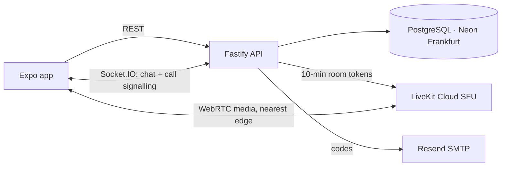

# LandConnect: technical documentation

## 1. Overview

LandConnect is a React Native app where buyers, sellers and brokers find land, talk about a specific plot, and call each other with in-app voice and video. No one's phone number is ever shown. It is a pnpm monorepo:

| Package | What it is |
|---|---|
| `apps/mobile` | Expo SDK 58 app (React Native 0.88, New Architecture, React Compiler) |
| `apps/api` | Node 24 API: Fastify 5, Socket.IO 4, Drizzle ORM on PostgreSQL, LiveKit server SDK |
| `packages/shared` | The contract: Zod schemas, DTO types, typed Socket.IO events, ₹ and land-unit formatters |



Production: the API runs in Docker on a VM in France behind Caddy (TLS), Postgres is on Neon in Frankfurt (same region), media is on LiveKit Cloud, and email goes through Resend. Details in [deploy/README.md](../deploy/README.md).

## 2. Technologies and why

| Need | Choice | Why |
|---|---|---|
| Mobile | Expo (dev build) + Expo Router + native tabs | One TypeScript codebase, cloud APK builds, native tab bar on both platforms |
| Media | LiveKit (open-source SFU, Cloud free tier) | Handles NAT/TURN on mobile networks, scales to group rooms, self-hostable. Media only: our server owns the call logic. |
| Signalling and chat | Socket.IO on the API | One connection for messages, typing, presence and call events; acks give request/response semantics |
| API | Fastify 5 + Zod type provider | Validation and handler types from one schema, OpenAPI for free, low overhead |
| Data | PostgreSQL + Drizzle | Constraints and enums in the database, typed queries, generated SQL migrations |
| Auth | Own JWT: argon2id, 15-min access, rotating refresh | The brief evaluates auth, so it's implemented rather than outsourced |
| Server state on mobile | TanStack Query | Caching, pagination, optimistic updates; socket events write into the same cache |
| Hosting | VM + Docker compose + Caddy, Neon Postgres, LiveKit Cloud, Resend | Free or near-free; one API instance (call state is in memory, see §7); DB next to the API; media at the edge nearest each phone |

Alternatives considered (Stream, Agora, ZEGOCLOUD, Daily, Jitsi, Twilio, raw WebRTC) are compared in [DECISIONS.md](DECISIONS.md).

## 3. Architecture

**Contract first.** Every request body, response type and socket event is defined once in `packages/shared`. If the app and API disagree, neither compiles.

**REST for state, sockets for events.** Listings, conversations, history and uploads are REST. Messages, typing, presence and the call lifecycle are Socket.IO. The server only ever emits to `user:<id>` rooms; the user id comes from the JWT verified in the handshake.

**Call lifecycle** (`apps/api/src/realtime/calls.ts`):

```
invite ─► ringing ─accept─► accepted ─end─► ended
            │ reject → rejected · cancel → cancelled · 30 s → missed
invite while either side is busy → busy
```

- Only members of a two-person conversation can call each other. A conversation only exists after a listing enquiry. The callee's "allow calls" setting and blocks are checked.
- Accept is atomic: the event loop is single-threaded, so the first accept removes the call from the ringing map and a second device gets "call ended". The caller's other devices receive `call:answered_elsewhere`.
- Each side gets a short-lived LiveKit token for room `call_<id>`. The callee's token comes back in the accept ack and the caller's in `call:accepted`, so both connect at once.
- Every terminal state goes through one `settle()`: it updates the `calls` row, posts a call bubble in the chat ("Video call · 2:14", "Missed voice call") and sends `call:closed` to both sides.
- A callee who reconnects while still being rung gets the invite replayed. A push notification wakes a backgrounded app.

**Privacy.** Other users' data leaves the API only through `toPublicUser()` / `toListing()`: no phone, no email, and approximate coordinates (about 1 km) unless you own the listing. An integration test fails if a phone number appears in any response.

**Hard limits at the boundary.** Every REST body and every socket event is validated against a Zod schema in `packages/shared`, so the app's inline form errors and the server use the same rule. Socket events go through one guard (`realtime/guard.ts`): schema check, 30 events per 10 s per socket, and no error can escape as an unhandled rejection. Names are letters in any script; emoji are allowed in chat, descriptions and room names but not in names, listing titles, places or RERA numbers. Uploads are accepted by their bytes (JPEG/PNG/WebP/HEIC magic numbers), max 4 MB and 100 a day per user.

**Deal rooms.** A seller or broker can group people they already have a 1:1 chat with (never a stranger by id), and nobody with a block in either direction; who blocked whom is never revealed. Members can see each other's names and roles, never numbers, and can leave.

**Authorization.** A role guard (`can('seller','broker')`) handles roles, and ownership is part of the SQL `WHERE`. Editing someone else's listing matches zero rows and returns 404.

## 4. Call quality

- **Audio:** Opus with DTX (no bandwidth during silence) and RED (redundant packets survive packet loss on 4G). The speech preset, plus echo cancellation, noise suppression and auto gain. The native audio session is configured before connecting: earpiece for voice, speaker for video, Bluetooth and headsets preferred.
- **Video:** 720p capture, H.264 first (hardware encoders on low-end phones), simulcast with dynacast and adaptive stream, so each phone receives only the resolution it displays.
- **Network:** WebSocket-only Socket.IO with fast ping and 60 s state recovery. Media runs on LiveKit Cloud, so each phone connects to its nearest edge. The call screen shows "Reconnecting…", and names whose connection is weak only after quality stays poor for 4 s (brief dips on mobile data are normal).
- **Phone behaviour:** ringback for the caller and a ringtone for the callee (generated in the repo), a speaker toggle while ringing that carries into the call, and an Android foreground service ("Ongoing call" notification) so a call or meeting survives minimising the app. Group meetings fill the screen like WhatsApp (2 halves, 1 + 2, 2 × 2, then two columns) with a ring on whoever is speaking.

## 5. Development approach

1. **Risk first.** Calling is the evaluated core and has the most unknowns, so the signalling state machine and its tests were built before the screens.
2. **Vertical slices.** Each feature goes from shared schema to API route and test, then to screen, in one commit.
3. **Real integration tests.** The API suite runs against a real Postgres and real Socket.IO clients: auth and refresh-token theft detection, RBAC, the no-phone-leak check, pagination, the map area filter, chat, blocking, and every call outcome.
4. **Quality gate.** `pnpm check` (Biome, tsc in every package, all tests) must pass before a commit. The mobile bundle is verified with `expo export`.

## 6. Challenges and how they were solved

| Challenge | Solution |
|---|---|
| WebRTC can't run in Expo Go | Expo development build with the LiveKit and WebRTC config plugins; APKs built on EAS |
| Opening the call screen as a route raced with navigation (incoming call during a screen transition) | The call UI is a root-level overlay driven by a Zustand store, so it can appear above anything |
| Two devices of the same user both answering | Atomic removal from the ringing map; other devices get `answered_elsewhere` |
| Free hosts wipe their disk on restart, losing uploaded photos | Photos are stored in Postgres and served with immutable cache headers. Phones compress them to about 1600 px (around 250 KB) first. |
| Cursor pagination returned an empty second page | Found by an integration test: the base64 cursor exceeded a length limit. Timestamps are also stored to the millisecond so cursors round-trip exactly. |
| A block didn't stop messages in an existing chat | Found while building the block UI; enforced on `message:send` with a regression test |
| **Release APK closed instantly on launch** (the dev build was fine) | Read the crash over `adb logcat`: R8 code shrinking had removed a class WorkManager's database loads by name. Turned R8 off for release builds (it would also have hit WebRTC's JNI classes). |
| **Photo upload failed only on Android** with "Can't reach LandConnect", while every other request worked | Server logs showed the upload never arrived. Expo SDK 58 replaces the global `fetch` with `expo/fetch`, which can't send React Native's `{ uri, name, type }` FormData part, so it threw before sending. Photos are now sent as an `expo-file-system` `File`, and the server decides the type from the bytes. |
| **A call took ~4 s to ring** on the hosted server | Measured per query: Neon was in Singapore and the API in France, ~165 ms per query, and an invite runs several in a row. Moved the database to Frankfurt: ~7 ms per query, ring in ~0.3 s. |
| **Video was soft and "your connection is weak" kept flashing** | LiveKit's server logs showed repeated "channel congestion": media went India → France → India through the self-hosted SFU. Moved media to LiveKit Cloud (connect time from India ~77 ms vs ~190 ms) and only warn when poor quality lasts 4 s. |
| **Ringing continued after Cancel or Accept**, and doubled when Speaker was tapped | `adb shell dumpsys audio` showed two of the app's players still playing: `remove()` in expo-audio doesn't stop a looping player on Android. One long-lived player per tone, paused to stop. |
| **A malformed socket message could crash the API** | A test sending `body: 12345` produced an unhandled rejection (`body?.trim is not a function`), which ends a Node 24 process and every call on it. Added a per-event schema guard with rate limiting; the test now passes. |
| **Rooms accepted any user id** | Found while adding the "no blocked people" rule: the API checked only that the ids existed. Now members must already share a 1:1 chat with the creator and have no block either way. |
| Chat messages hid behind the keyboard and a sent message landed out of view | The list now shrinks with the keyboard, and the chat scrolls to a new message if you sent it or were already at the bottom (FlashList keeps visible rows still when a row is added at the start). |
| Map price pins were blank on Android | Custom markers were frozen into bitmaps before their text laid out; they now track changes briefly, then freeze for smooth panning. |
| Pull-to-refresh spinner got stuck on Android | It flipped on and off within a frame because the API answers in ~100 ms; it now stays up at least 600 ms and is tied only to the user's pull. |

## 7. Limitations and next steps

- **Push when the app is closed:** the server sends Expo pushes for calls and for messages to offline members, but Android delivery needs a Firebase (FCM) project and `google-services.json` in the build. Until then nobody has a push token; in-app banners and ringing work while the app is open or minimised.
- **iOS:** the code is cross-platform, but only Android builds were made and tested.
- **Lock-screen ringing:** push wakes the app, but a full-screen incoming call needs `react-native-callkeep` (CallKit / ConnectionService) with VoIP push.
- **Single API instance:** call state is in memory. To scale out: Socket.IO Redis adapter plus Redis `SET NX` for accept.
- **Search:** `ILIKE` and a bounding-box filter. Next: `pg_trgm` for fuzzy search, PostGIS for radius queries.
- **Images:** Postgres is fine up to about 1 GB. Beyond that, object storage plus a CDN.
- **Trust:** RERA verification is a manual flag. Phone OTP and document verification are next.
