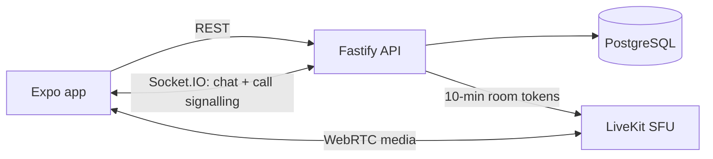

# LandConnect: technical documentation

## 1. Overview

LandConnect is a React Native app where buyers, sellers and brokers find land, talk about a specific plot, and call each other with in-app voice and video. No one's phone number is ever shown. It is a pnpm monorepo:

| Package | What it is |
|---|---|
| `apps/mobile` | Expo SDK 58 app (React Native 0.88, New Architecture, React Compiler) |
| `apps/api` | Node 24 API: Fastify 5, Socket.IO 4, Drizzle ORM on PostgreSQL, LiveKit server SDK |
| `packages/shared` | The contract: Zod schemas, DTO types, typed Socket.IO events, ₹ and land-unit formatters |



## 2. Technologies and why

| Need | Choice | Why |
|---|---|---|
| Mobile | Expo (dev build) + Expo Router + native tabs | One TypeScript codebase, cloud APK builds, native tab bar on both platforms |
| Media | LiveKit (open-source SFU, Cloud free tier) | Handles NAT/TURN on mobile networks, scales to group rooms, self-hostable. Media only: our server owns the call logic. |
| Signalling and chat | Socket.IO on the API | One connection for messages, typing, presence and call events; acks give request/response semantics |
| API | Fastify 5 + Zod type provider | Validation and handler types from one schema, OpenAPI for free, low overhead |
| Data | PostgreSQL + Drizzle | Constraints and enums in the database, typed queries, generated SQL migrations |
| Auth | Own JWT: argon2id, 15-min access, rotating refresh | The brief evaluates auth, so it's implemented rather than outsourced |
| Server state on mobile | TanStack Query | Caching, pagination, optimistic updates; socket events write into the same cache |

Alternatives considered (Stream, Agora, ZEGOCLOUD, Daily, Jitsi, Twilio, raw WebRTC) are compared in [DECISIONS.md](DECISIONS.md).

## 3. Architecture

**Contract first.** Every request body, response type and socket event is defined once in `packages/shared`. If the app and API disagree, neither compiles.

**REST for state, sockets for events.** Listings, conversations, history and uploads are REST. Messages, typing, presence and the call lifecycle are Socket.IO. The server only ever emits to `user:<id>` rooms; the user id comes from the JWT verified in the handshake.

**Call lifecycle** (`apps/api/src/realtime/calls.ts`):

```
invite ─► ringing ─accept─► accepted ─end─► ended
            │ reject → rejected · cancel → cancelled · 30 s → missed
invite while either side is busy → busy
```

- Only members of a two-person conversation can call each other. A conversation only exists after a listing enquiry. The callee's "allow calls" setting and blocks are checked.
- Accept is atomic: the event loop is single-threaded, so the first accept removes the call from the ringing map and a second device gets "call ended". The caller's other devices receive `call:answered_elsewhere`.
- Each side gets a short-lived LiveKit token for room `call_<id>`. The callee's token comes back in the accept ack and the caller's in `call:accepted`, so both connect at once.
- Every terminal state goes through one `settle()`: it updates the `calls` row, posts a call bubble in the chat ("Video call · 2:14", "Missed voice call") and sends `call:closed` to both sides.
- A callee who reconnects while still being rung gets the invite replayed. A push notification wakes a backgrounded app.

**Privacy.** Other users' data leaves the API only through `toPublicUser()` / `toListing()`: no phone, no email, and approximate coordinates (about 1 km) unless you own the listing. An integration test fails if a phone number appears in any response.

**Authorization.** A role guard (`can('seller','broker')`) handles roles, and ownership is part of the SQL `WHERE`. Editing someone else's listing matches zero rows and returns 404.

## 4. Call quality

- **Audio:** Opus with DTX (no bandwidth during silence) and RED (redundant packets survive packet loss on 4G). The speech preset, plus echo cancellation, noise suppression and auto gain. The native audio session is configured before connecting: earpiece for voice, speaker for video, Bluetooth and headsets preferred.
- **Video:** 720p capture, H.264 first (hardware encoders on low-end phones), simulcast with dynacast and adaptive stream, so each phone receives only the resolution it displays.
- **Network:** WebSocket-only Socket.IO with fast ping and 60 s state recovery. The call screen shows "Reconnecting…" and names whose connection is weak.

## 5. Development approach

1. **Risk first.** Calling is the evaluated core and has the most unknowns, so the signalling state machine and its tests were built before the screens.
2. **Vertical slices.** Each feature goes from shared schema to API route and test, then to screen, in one commit.
3. **Real integration tests.** The API suite runs against a real Postgres and real Socket.IO clients: auth and refresh-token theft detection, RBAC, the no-phone-leak check, pagination, the map area filter, chat, blocking, and every call outcome.
4. **Quality gate.** `pnpm check` (Biome, tsc in every package, all tests) must pass before a commit. The mobile bundle is verified with `expo export`.

## 6. Challenges and how they were solved

| Challenge | Solution |
|---|---|
| WebRTC can't run in Expo Go | Expo development build with the LiveKit and WebRTC config plugins; APKs built on EAS |
| Opening the call screen as a route raced with navigation (incoming call during a screen transition) | The call UI is a root-level overlay driven by a Zustand store, so it can appear above anything |
| Two devices of the same user both answering | Atomic removal from the ringing map; other devices get `answered_elsewhere` |
| Free hosts wipe their disk on restart, losing uploaded photos | Photos are stored in Postgres and served with immutable cache headers. Phones compress them to about 1600 px (around 250 KB) first. |
| Cursor pagination returned an empty second page | Found by an integration test: the base64 cursor exceeded a length limit. Timestamps are also stored to the millisecond so cursors round-trip exactly. |
| A block didn't stop messages in an existing chat | Found while building the block UI; enforced on `message:send` with a regression test |
| `<Fill in what you hit on real devices: e.g. audio routing, 4G NAT, background ringing>` | |

## 7. Limitations and next steps

- **Lock-screen ringing:** push wakes the app, but a full-screen incoming call needs `react-native-callkeep` (CallKit / ConnectionService) with VoIP push.
- **Single API instance:** call state is in memory. To scale out: Socket.IO Redis adapter plus Redis `SET NX` for accept.
- **Search:** `ILIKE` and a bounding-box filter. Next: `pg_trgm` for fuzzy search, PostGIS for radius queries.
- **Images:** Postgres is fine up to about 1 GB. Beyond that, object storage plus a CDN.
- **Trust:** RERA verification is a manual flag. Phone OTP and document verification are next.
