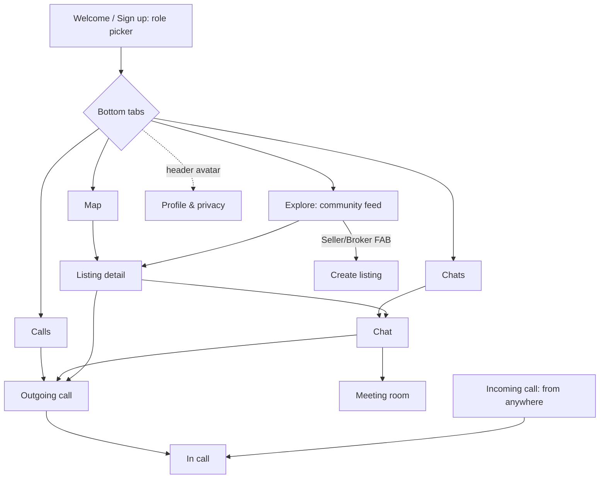

# LandConnect: UX specification

The clickable version of this spec is `mockup/index.html`.

## 1. Principles
1. **Feels like WhatsApp, looks like LandConnect.** Borrow the interaction model people already know (bottom tabs, chat list, call buttons in the chat header, full-screen call UI, call log). Don't copy WhatsApp's colours, logo or icons.
2. **Every conversation is about a piece of land.** The listing card is pinned at the top of each chat, and the chats list shows which listing a thread is about.
3. **Privacy is visible.** Small lock notes ("Phone hidden · chat and call in the app") build trust at the exact moments people worry about it.
4. **Two taps to talk.** Listing → Chat or Call. A call from a listing creates the enquiry conversation behind the scenes.
5. **Land-native content.** Indian units, ₹ lakh/crore, price per unit, and title-document vocabulary.

## 2. Information architecture

Four tabs, like WhatsApp: **Explore · Map · Chats · Calls**. The profile opens from the avatar in the header. "List land" is a floating action button on Explore, shown only to Sellers and Brokers.

## 3. Screens

| Screen | Purpose | Key elements | States | Role rules |
|---|---|---|---|---|
| Welcome / Sign up | Create an account with a role | Role cards (Buyer · Seller · Broker with a one-line meaning), email/phone, password, RERA licence field for Brokers | Field errors inline; loading on the button | Broker must enter a licence number |
| Explore | Browse land | Search pill, type chips, listing cards (photo, type tag, price + per-unit chip, title, place · area, owner + role badge, age) | Skeleton cards; empty filter state; offline banner | FAB for Seller/Broker only |
| Listing detail | Decide whether to talk | Photo gallery with counter, price, specs grid (area, type, road, water, title, zoning), description, mini-map, owner card with "Phone hidden", sticky action bar | Sold tag; approximate-location note | Owner sees Edit + Mark sold instead of Chat/Call |
| Map | Browse geographically | Price-label markers, "you are here", bottom-sheet preview card | Loading markers on pan; "zoom in to see more" | All |
| Chats | Ongoing deals | Rows: avatar, name, last message, time, unread badge, "re: listing" line; deal rooms with a group icon | Empty: "Enquire on a listing to start a chat" | "New deal room" for Seller/Broker |
| Chat | Talk | Header: avatar, name, role · online, video + voice buttons; pinned listing strip; bubbles with time + ticks; call-summary bubbles; system notes; composer with attach | Sending / failed (tap to retry); typing indicator | Rooms show "Join meeting" instead of 1:1 call buttons |
| Outgoing call | Waiting | Big avatar with pulse, name, "Ringing", listing context, Cancel | Busy / declined / no answer → toast + back | — |
| Incoming call | Decide | "Incoming video call", avatar, role, "number hidden", listing context, 30 s countdown, Decline / Accept, quick-reply decline | Auto-missed at 0 | — |
| In call | Talk | Remote video full screen, self preview in a corner, name + timer, controls: flip, camera, mute, end (voice: speaker, mute, end) | Reconnecting; peer's camera off shows their avatar | — |
| Meeting room | Group call | 2×2 grid tiles with names and mute icons, invite tile, same controls | One person alone: "Waiting for others" | Rooms created by Seller/Broker |
| Calls | History | "Start a meeting room" row; entries with direction arrow (red if missed/declined), time, duration, call-back button | Empty: "No calls yet" | — |
| Create listing | Publish land | Photo grid, title, type chips, area + unit, price with live ₹ L/Cr preview, description, map pin picker + "Use my location", approximate-location toggle, Publish | Field errors; upload progress per photo | Seller/Broker only; Broker gets a private "Land owner" field |
| Profile & privacy | Control exposure | Role badge (+ RERA for brokers), phone visibility, who can call me, approximate location, read receipts, blocked people, my listings, log out | — | My listings section for Seller/Broker |

## 4. Key flows

**Buyer to first call (the demo's core):** Explore → listing → **Chat** (conversation created, system note about privacy) → header **video icon** → seller's phone rings → **Accept** → talk → **End** → "Video call · 2:14" bubble in chat and an entry in Calls.

**Decline / miss:** incoming → **Decline** (caller sees "Call declined") or wait 30 s (both sides log "Missed"). Quick reply: "Can't talk now" declines and posts the message.

**Seller lists land:** FAB → photos → title → type → area 2.5 acre → price 1,12,00,000 (preview shows "₹ 1.12 Cr") → tap the map / Use my location → Publish → the card appears at the top of Explore with a "Your listing" tag.

**Deal room:** Seller or broker → Chats → New deal room → pick listing + buyers who enquired → room chat → **Join meeting** → grid call.

## 5. Visual system

| Token | Light | Dark | Use |
|---|---|---|---|
| `brand` | `#1C6A4E` forest | `#2E9470` | Header, primary buttons, active states |
| `accent` | `#B87A0C` harvest | `#E3AC45` | Price-per-unit chips, seller badge, system notes |
| `app` | `#F5F7F3` | `#0C1310` | Screen background |
| `surface` | `#FFFFFF` | `#151E19` | Cards, nav bar |
| `out` / `in` bubbles | `#D6EEDF` / `#FFFFFF` | `#1E4A37` / `#1B2620` | Chat |
| `danger` / `ok` | `#D23B3B` / `#1E9E5E` | `#F06060` / `#3CC983` | End call, missed / accept, unread |

- **Type:** system font in the app (Roboto / SF Pro) for familiarity; prices use tabular numbers.
- **Scale:** 12 / 14 / 16 / 18 / 22 / 26.
- **Shape:** cards 16 px radius; buttons 12 px; chips and pills fully rounded.
- **Spacing:** 4-pt grid; screen padding 14–16.
- **Icons:** Lucide, 2 px stroke. Call controls are 52–64 px round targets.
- **Motion:** avatar pulse while ringing; 200 ms transitions; respect Reduce Motion.

## 6. Land-specific content rules
- **Price:** `₹ 58 L`, `₹ 1.12 Cr` (Indian grouping when written out: `1,12,00,000`). Always show price per unit next to the total.
- **Units:** acre, guntha (1,089 sq ft), cent (435.6 sq ft), sq ft, sq yd, hectare. Store the seller's unit plus a normalised sq ft value for sorting.
- **Specs:** road access (width in ft), water source (borewell / canal / lake / municipal), title documents (RTC / Pahani, 7/12 extract, Khata, EC), zoning (agricultural / converted / residential / commercial).
- **Location text:** village or locality, taluk / city, district. Never the survey number publicly.

## 7. States and accessibility
- **Loading:** skeletons for feed and chats, not spinners.
- **Errors:** say what failed and how to fix it ("Couldn't send. Tap to retry").
- **Offline:** banner; queue outgoing messages; disable call buttons with the reason.
- **Permissions:** explain before the OS prompt (camera, mic, location, notifications); if denied, show an Open Settings button.
- **Accessibility:** 48 dp minimum targets, `accessibilityLabel` on every icon button ("Video call Ramesh K."), 4.5:1 text contrast, support for large font sizes, the incoming-call screen announced by screen readers.
